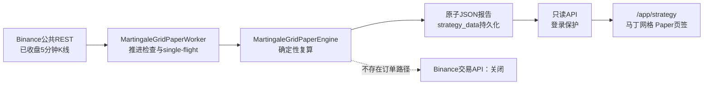

# 合约马丁网格策略研究与系统交接

本文件是马丁网格专题；BTC ICT V5、Route B、ETH因子及整体研究总览见 `STRATEGY_BTC_ETH_HANDOFF.md`。

更新时间：2026-07-17
适用对象：策略研究、后端、前端、测试、项目管理
当前生产路线：`binance-usdm-martingale-grid-paper-v1`
性质：只读自动 Paper 与历史研究，不具备交易所下单能力

## 1. 一页结论

当前实现是一套“趋势过滤 + 有限层数逆向加仓 + 整组退出”的合约马丁网格 Paper。它不是无限补仓，也不是无止损网格。

- 市场：Binance USD-M `BTCUSDT`、`ETHUSDT` 永续。
- 当前自动 Paper：15分钟 EMA 趋势过滤，5分钟 RSI 回撤触发，下一根5分钟开盘执行。
- 初始 Paper 权益：组合10,000 USDT，BTC/ETH各5,000 USDT独立计算。
- 仓位：5x隔离风险模型；首层保证金占单标的权益0.5%；1.35倍递增；最多5层。
- 风险：整组计划损失不超过开组权益1.5%，最长持仓24小时；亏损后该标的当个UTC日暂停。
- 执行成本：每边0.045% Taker手续费，每次成交1 bp不利滑点。
- 自动化边界：服务会自动读取公开行情并更新 Paper 报告，但不会连接 Binance交易API、不会读取API key、不会发送订单。
- 历史结论：5分钟V1基础成本下略有正收益，但平均R过低、双倍成本后转负，历史资格不通过。
- 15分钟V2结论：机械地把RSI/ATR从5分钟放大到15分钟后，BTC/ETH合格信号均为0，已否决；当前自动Paper没有切换到V2。

## 2. 当前状态与交接边界

### 已完成

- 自动 Paper Worker：服务启动后自动检查公开已收盘K线，K线推进后确定性复算并原子保存报告。
- 用户端只读报告接口与K线接口。
- `/app/strategy` 的“马丁网格 Paper”页签，可显示BTC/ETH K线、分层开仓和整组平仓标记。
- 2021-01-01至2026-07-15的V1历史复算、双倍成本压力测试与确定性复现。
- “15分钟趋势 + 15分钟RSI”的V2受控实验与确定性复现。

### 当前没有做

- 没有 Binance交易API、真实订单、撤单或持仓同步。
- 没有保存或读取 Binance API key、私钥、助记词。
- 没有真实资金、Testnet订单或Mainnet订单。
- 没有历史资金费率、Mark Price、动态风险限额、真实强平引擎或盘口冲击建模。
- 没有将V1或V2认定为可实盘策略。
- 没有把15分钟V2写入当前生产Paper报告。

### 仓库快照

- Worktree：`/Users/dq/.codex/worktrees/2c58/xingheng`
- 分支：`develop`
- 本文编写时HEAD：`131eb12`
- 工作区：存在共享未提交改动；不得覆盖其他对话的前端或研究改动。
- 本文编写时本机 `5173 / 8787` 没有监听服务。
- 生产已发布V1自动Paper与用户端页签；15分钟V2仅为本地研究记录，未提交、未推送、未部署。

## 3. 核心概念

### Paper、回测与前向验证

- **历史回测**：在已经发生的历史K线上按固定规则模拟成交，用于否决不稳健策略，不能证明未来盈利。
- **自动 Paper**：服务持续读取新产生的公开行情，用虚拟权益和同一套规则自动记账，不发送交易所订单。
- **前向验证**：参数冻结后，只使用冻结时点之后新产生的数据观察表现；比反复查看历史并调参更接近真实检验。
- **实盘交易**：需要订单权限、账户状态、真实保证金、强平、资金费率和成交回报；当前路线不具备这些能力。

### 马丁网格相关

- **网格组**：从第一层开仓开始，到整组止盈、整组止损或超时退出为止的一次完整交易。
- **层**：价格向不利方向移动一个网格距离后增加的仓位。当前最多5层。
- **马丁倍率**：下一层名义价值相对上一层的倍率，当前为1.35，并非经典2倍马丁。
- **加权平均成本**：`Σ(成交价 × 数量) / Σ数量`。所有层共用一个整组目标。
- **有限马丁**：层数、整组风险、最长持仓都有硬上限；到达上限后不再补仓。
- **保证金**：为合约仓位占用的抵押资金。
- **名义价值**：价格乘数量；5倍杠杆下，0.5%权益保证金对应约2.5%权益名义价值。

### 指标与绩效

- **EMA**：指数移动平均线。当前用15分钟EMA50/200判断趋势方向。
- **RSI**：相对强弱指标。V1用5分钟RSI(14)的30/70阈值穿越寻找趋势中的短期逆向波动。
- **ATR**：平均真实波幅，衡量近期绝对波动；真实波幅取当根高低差、相对前收盘上跳和下跳三者最大值。
- **R**：单组净盈亏除以开组时的计划风险。`+1R`表示盈利等于计划风险，`-1R`表示损失约等于计划风险。
- **PF（Profit Factor）**：总盈利除以总亏损绝对值。PF大于1只表示样本内总盈利超过总亏损，不代表稳健。
- **最大盯市回撤**：逐K线计算的权益从历史峰值到后续低点的最大跌幅，包含未实现盈亏。
- **滑点**：模拟成交价相对触发价的不利偏移。当前每次成交计1 bp，即0.01%。
- **Taker手续费**：主动成交手续费；当前每边0.045%。
- **胜率陷阱**：马丁策略可能大量小赢、少量大亏。当前V1胜率97.84%，但平均仅0.0049R，一次平均整组止损约需38次平均止盈弥补。

### 数据与工程

- **已收盘K线**：只有K线结束后才允许用于信号，避免使用尚会变化的数据。
- **未来数据 / Look-ahead**：在历史时点读取当时尚未知的信息。当前信号收盘确认，下一根5分钟开盘执行。
- **Checksum**：对下载文件计算SHA256并与Binance官方校验文件比较，防止损坏或错误缓存进入研究。
- **缺口**：相邻5分钟K线时间差超过300秒。历史研究发现缺口即失败；自动Paper发现缺口时保留旧报告。
- **Single-flight**：同一时刻只允许一个Worker复算，避免重复运行互相覆盖。
- **原子写入**：先写临时文件，再rename替换正式报告；读取方不会看到半份JSON。
- **同K线路径不确定性**：OHLC无法知道K线内部先到高点还是低点。当前采用不利优先顺序减少过度乐观。

## 4. 数据源来源

当前有两类数据源，不能混为一谈。

### 4.1 历史研究：Binance Vision官方归档

用途：多年历史回测、年度分段、层数统计、成本压力测试。

- 来源域名：`https://data.binance.vision`
- 市场目录：`data/futures/um`，即USD-M / U本位合约。
- 当前标的：`BTCUSDT`、`ETHUSDT`。
- 当前周期：`5m`。
- 月度根目录：`https://data.binance.vision/data/futures/um/monthly/klines`
- 日度根目录：`https://data.binance.vision/data/futures/um/daily/klines`

月文件示例：

```text
https://data.binance.vision/data/futures/um/monthly/klines/BTCUSDT/5m/BTCUSDT-5m-2024-01.zip
https://data.binance.vision/data/futures/um/monthly/klines/BTCUSDT/5m/BTCUSDT-5m-2024-01.zip.CHECKSUM
```

日文件示例：

```text
https://data.binance.vision/data/futures/um/daily/klines/ETHUSDT/5m/ETHUSDT-5m-2026-07-15.zip
https://data.binance.vision/data/futures/um/daily/klines/ETHUSDT/5m/ETHUSDT-5m-2026-07-15.zip.CHECKSUM
```

代码会：

1. 下载ZIP与官方 `.CHECKSUM`。
2. 计算ZIP的SHA256并逐文件验证。
3. 解压CSV并标准化为内部K线。
4. 按时间排序、去重、检查每个5分钟时间桶。
5. 将解析缓存与原ZIP的SHA256绑定；源文件变化时旧解析缓存不能绕过校验。

本地缓存：`.cache/strategy/binance-vision/{SYMBOL}/5m/`，不进入Git。

当前历史K线解析并保留以下字段：

```text
openTime, open, high, low, close, volume,
quoteVolume, tradeCount, takerBuyBaseVolume, takerBuyQuoteVolume
```

马丁网格V1实际只使用OHLCV生成EMA、RSI、ATR与撮合；额外成交统计字段没有进入当前信号。

重要口径：

- 当前没有使用用户曾发来的 `futures/cm` 币本位目录。
- 当前没有使用 `1m` 目录；历史策略基准是U本位 `5m`。
- 2020-12只用于指标预热；绩效从2021-01-01开始。
- 本轮历史终点固定为2026-07-15 23:55 UTC。
- 不允许用实时REST静默填补历史归档缺口。

### 4.2 自动Paper与页面K线：Binance Futures公共REST

用途：前向新K线检查、自动Paper重算、用户端图表。

基础接口：

```text
https://fapi.binance.com/fapi/v1/klines
```

Worker请求示意：

```text
GET /fapi/v1/klines?symbol=BTCUSDT&interval=5m&startTime=...&endTime=...&limit=1500
```

- 不需要API key。
- 只接受已经收盘的K线。
- 先轻量读取最新K线；BTC或ETH有closed candle推进才重取前向窗口并复算。
- 上游超时、限频、空响应或数据缺口不会清空旧报告，也不会让主服务退出。
- REST响应没有官方逐请求Checksum，因此其保证弱于Binance Vision归档；前向侧通过数值校验、排序、去重、已收盘过滤和缺口检查降低风险。

### 4.3 当前没有使用的市场数据

- Tick-by-tick逐笔成交没有接入当前马丁网格。
- Binance `aggTrades` / `trades` 可作为未来更细成交研究候选，但不能与当前5分钟结果直接混用。
- 历史订单簿深度、买卖价差和真实市场冲击没有建模。
- 资金费率、Mark Price、保险基金、ADL和动态杠杆档位没有纳入。
- 因此当前结果不能用于推断真实大仓位的成交能力或强平概率。

## 5. 当前V1规则

### 5.1 方向与首层入场

多单：

1. 已完成15分钟EMA50高于EMA200。
2. 同一已完成15分钟收盘高于EMA50。
3. 5分钟RSI(14)从30上方下穿至不高于30。
4. 信号收盘确认后，下一根5分钟K线开盘建立第一层。

空单完全镜像：EMA50低于EMA200、收盘低于EMA50，5分钟RSI从70下方上穿至不低于70。

每个标的同一时间最多一个网格组；BTC与ETH可以各持有一组。

### 5.2 分层仓位

单标的初始权益5,000 USDT，第一层保证金占权益0.5%。各层保证金和名义敞口约为：

| 层 | 保证金占权益 | 5x名义价值占权益 | 累计名义价值占权益 |
| ---: | ---: | ---: | ---: |
| 1 | 0.500% | 2.500% | 2.500% |
| 2 | 0.675% | 3.375% | 5.875% |
| 3 | 0.911% | 4.556% | 10.431% |
| 4 | 1.230% | 6.151% | 16.582% |
| 5 | 1.661% | 8.304% | 24.886% |

网格距离在首次入场时冻结：

```text
gridStep = max(0.75 × 入场时ATR(14), 首次成交价 × 0.35%)
```

价格每向不利方向移动一个 `gridStep`，触发下一层，最多5层。

### 5.3 整组退出

每次加层后重算加权平均成本。目标距离在首层入场时冻结：

```text
targetDistance = max(0.5 × 入场时ATR(14), 首次成交价 × 0.25%)
多单目标 = 加权均价 + targetDistance
空单目标 = 加权均价 - targetDistance
```

结构止损位于最后计划层之外2个网格距离。如果该结构止损令计划全部层的损失、手续费和退出滑点超过开组权益1.5%，止损会自动收紧到1.5%计划现金风险边界。

其他退出：

- 24小时仍未结束：按当根开盘不利成交超时退出。
- 某标的整组净亏损：该标的当个UTC自然日不再开新组。

### 5.4 同K线保守撮合

同一根5分钟K线同时覆盖多个价格时，顺序固定为：

1. 依次触发可达的加仓层。
2. 检查整组止损。
3. 最后检查整组止盈。

若开盘已经跳过止损，使用开盘价和止损价中更不利的一侧，再加入退出滑点。

## 6. 自动Paper系统



### Worker

- 服务启动：立即检查一次。
- 默认轮询：300,000ms，即5分钟；允许5,000–300,000ms。
- 只有BTC或ETH最新已收盘K线推进才执行完整重算。
- 两个标的任一发生缺口则不覆盖上一份有效报告。
- 报告采用临时文件加rename原子写入。

环境变量：

```text
MARTINGALE_GRID_PAPER_WORKER_ENABLED=true
MARTINGALE_GRID_PAPER_WORKER_POLL_MS=300000
MARTINGALE_GRID_PAPER_REPORT_PATH=/app/strategy-data/martingale-grid-paper.json
```

本地默认报告：

```text
server/data/strategy/research-martingale-grid-paper.json
```

### 观察门槛

- 前向开始：`2026-07-16T19:20:00.000Z`，北京时间2026-07-17 03:20。
- 累计60天或100个已完成网格组任一先达到，状态转为待人工复核。
- 门槛达到不等于自动通过，不会解锁真实订单。

## 7. 用户端与接口

所有马丁接口都要求用户登录。

### Paper报告

```http
GET /api/strategy/martingale/forward
```

主要内容：

- 路线、前向起点、数据截止时间、观察门槛。
- Paper假设和冻结配置。
- 完成组数、总成交层数、已实现/未实现盈亏、PF、平均R、最大盯市回撤、费用。
- 信号、开组、止盈、止损、超时和每日锁定诊断。
- 当前BTC/ETH网格组与最近50个已完成组。
- Worker运行、最近尝试/成功、最新K线、连续失败和错误码。

安全状态：

- 未登录：`401`。
- 没有报告：`200 + status=unavailable + warnings=["no_report"]`。
- 报告损坏：安全的`503 + warnings=["report_unreadable"]`。
- 没有亏损样本时PF为`null`，前端应显示`—`，不能显示0。

### K线图

```http
GET /api/strategy/martingale/candles?symbol=BTCUSDT&interval=5m&from=...&to=...&limit=500
```

- 标的：`BTCUSDT / ETHUSDT`。
- 周期：`5m / 15m / 1h / 4h`。
- 单次最多1,000根，只返回已收盘K线。
- 开仓标记来自 `fills[].time / fills[].price`。
- 整组平仓标记来自 `exitTime / exitPrice`。
- 接口与页面都只读，不提供启动、停止、跟单、调杠杆或下单按钮。

### 管理员健康检查

```http
GET /api/admin/strategy/health
```

返回马丁报告可读性与Worker状态；鉴权和管理员边界沿用现有后台规则。

## 8. 历史回测口径与结果

### 数据区间

- 预热：2020-12-01至2020-12-31。
- 评价：2021-01-01至2026-07-15。
- BTC：591,264根5分钟K线。
- ETH：591,264根5分钟K线。
- 两标的官方Checksum通过，重复0，缺口0。

### V1结果

| 范围 | 完成组 | 胜率 | 净收益 | PF | 平均R | 最大盯市回撤 | 费用 |
| --- | ---: | ---: | ---: | ---: | ---: | ---: | ---: |
| 组合 | 1,622 | 97.84% | +160.53 | 1.304 | 0.0049R | 0.91% | 427.07 |
| BTC | 789 | 97.59% | +26.23 | 1.093 | 0.0018R | 1.42% | 200.14 |
| ETH | 833 | 98.08% | +134.31 | 1.546 | 0.0079R | 1.06% | 226.93 |

年度组合：

| 年度 | 完成组 | 净收益 | PF | 平均R |
| --- | ---: | ---: | ---: | ---: |
| 2021 | 270 | +14.65 | 1.144 | 0.0009R |
| 2022 | 322 | -8.53 | 0.942 | -0.0035R |
| 2023 | 263 | +22.10 | 1.271 | 0.0051R |
| 2024 | 280 | +78.72 | 3.372 | 0.0165R |
| 2025 | 300 | +47.98 | 1.583 | 0.0091R |
| 2026至07-15 | 187 | +5.61 | 1.068 | 0.0012R |

双倍手续费与滑点：1,616组，净亏损411.63 USDT，PF 0.378，平均 `-0.0153R`，最大回撤4.43%，费用843.56 USDT。

资格未通过的硬原因：

1. 平均R `0.0049R`，低于预注册 `0.10R`。
2. 双倍成本PF `0.378`，低于 `1.00`。

因此不能通过提高杠杆、增加第一层仓位或放宽止损来放大V1。

### 15分钟入场V2

V2唯一变化：RSI(14)和ATR(14)改为已完成15分钟K线，信号后下一根5分钟开盘执行；其他V1规则完全不变。

| 标的 | 合格信号 | 完成组 |
| --- | ---: | ---: |
| BTCUSDT | 0 | 0 |
| ETHUSDT | 0 | 0 |

同周期15分钟趋势条件与15分钟RSI极值条件在样本内没有同时成立。V2已否决，但不能外推为所有15分钟策略无效。

## 9. 复现方式

V1：

```bash
npx tsx scripts/research-martingale-grid-history-v1.ts
```

输出：`research-martingale-grid-history-v1.json`。

V2：

```bash
MARTINGALE_RESEARCH_SIGNAL_INTERVAL=15 npx tsx scripts/research-martingale-grid-history-v1.ts
```

输出：`research-martingale-grid-15m-entry-v2.json`。

报告与缓存由 `.gitignore` 排除；研究结论文档进入Git。复算要求系统存在 `unzip`，首次运行需要访问Binance Vision。

验证命令：

```bash
npx tsc -p tsconfig.server.json --noEmit
npx tsx --test server/modules/strategy/**/*.test.ts
git diff --check
```

最近一次相关验证：策略测试125/125通过，Server TypeScript通过，5分钟V1指标精确回归，15分钟V2两次完整运行哈希一致。

## 10. 主要代码与文档

| 作用 | 文件 |
| --- | --- |
| 策略、撮合、指标、Binance REST加载 | `server/modules/strategy/runtime/MartingaleGridPaperEngine.ts` |
| 自动Paper Worker | `server/modules/strategy/runtime/MartingaleGridPaperWorker.ts` |
| 报告读取、归一化和安全空态 | `server/modules/strategy/runtime/MartingaleGridReportService.ts` |
| Binance Vision历史数据与Checksum | `server/modules/strategy/backtest/BinanceVisionHistoricalDataSource.ts` |
| 历史复算脚本 | `scripts/research-martingale-grid-history-v1.ts` |
| 用户与管理员接口 | `server/modules/api/strategyRoutes.ts` |
| 策略接口登录保护 | `server/modules/auth/authRoutes.ts` |
| Worker启动与停止 | `server/index.ts` |
| 前端请求 | `src/api/strategy.ts` |
| 页面 | `src/features/strategy/components/MartingaleStrategyView.tsx` |
| V1规则 | `STRATEGY_MARTINGALE_GRID_PAPER_V1.md` |
| V1预注册与结果 | `docs/strategy/archive/STRATEGY_MARTINGALE_GRID_HISTORY_V1.md`、`docs/strategy/archive/STRATEGY_MARTINGALE_GRID_HISTORY_V1_RESULT.md` |
| V2预注册与结果 | `docs/strategy/archive/STRATEGY_MARTINGALE_GRID_15M_ENTRY_V2.md`、`docs/strategy/archive/STRATEGY_MARTINGALE_GRID_15M_ENTRY_V2_RESULT.md` |

## 11. 风险与解释限制

- 历史样本已被查看；2021至2026-07-15不能再称为新路线的干净留出集。
- 当前最可信的新证据是冻结参数后的前向Paper，而不是继续围绕同一历史调整阈值。
- V1高胜率来自大量小额止盈，不能单独作为策略质量证据。
- 费用超过最终净利润；真实费率、点差或市场冲击稍差就可能转负。
- OHLC回测不能恢复K线内真实成交顺序；当前虽采用不利优先，仍不等同tick级复盘。
- 资金费率和真实强平被忽略，持仓时间最长24小时，历史结果可能高估净收益或低估尾部风险。
- Paper的5x隔离风险模型是研究假设，不是Binance实际账户状态。
- Worker成功只表示数据与报告链路正常，不表示策略盈利。
- 观察门槛达到只触发人工复核，不允许自动升级为真实交易。

## 12. 推荐下一步

下一项合理研究不是继续放宽V1，而是建立独立V3：

```text
已完成1小时趋势过滤
        ↓
已完成15分钟回撤/结构信号
        ↓
下一根5分钟开盘执行
        ↓
有限5层网格与独立风险上限
```

V3必须先预注册，再进行唯一一次历史运行，并至少比较：机会数、PF、平均R、费用/净利润、双倍成本PF、逐年稳定性、BTC/ETH分标的、层数分布和最大盯市回撤。即使历史通过，也只能进入独立routeId的前向Paper，不能覆盖V1失败记录。

## 13. 固定交接信息

交接对象：策略研究 / 后端 / 前端 / 测试。
触发原因：需要在切换对话、账号或owner时保留马丁网格完整口径。
已完成：V1自动Paper、只读接口与页面、历史复算；V2 15分钟受控实验。
影响接口：`GET /api/strategy/martingale/forward`、`GET /api/strategy/martingale/candles`、`GET /api/admin/strategy/health`。
下一步：如继续15分钟路线，先建立1小时趋势 + 15分钟入场V3预注册，不修改当前V1 Paper。
不属于本轮：真实下单、API key、资金费率、Mark Price、真实清算、主网资金。
风险 / 阻塞：V1历史资格未通过；V2零信号；当前没有可宣称正期望或可实盘的马丁网格候选。
